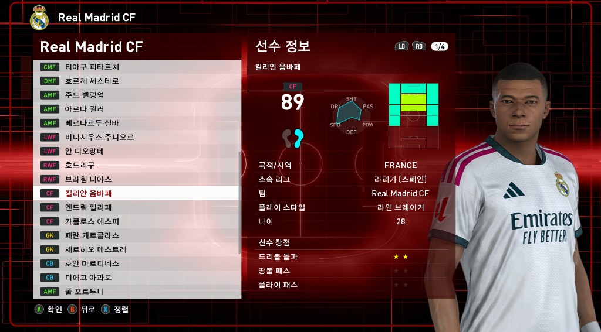
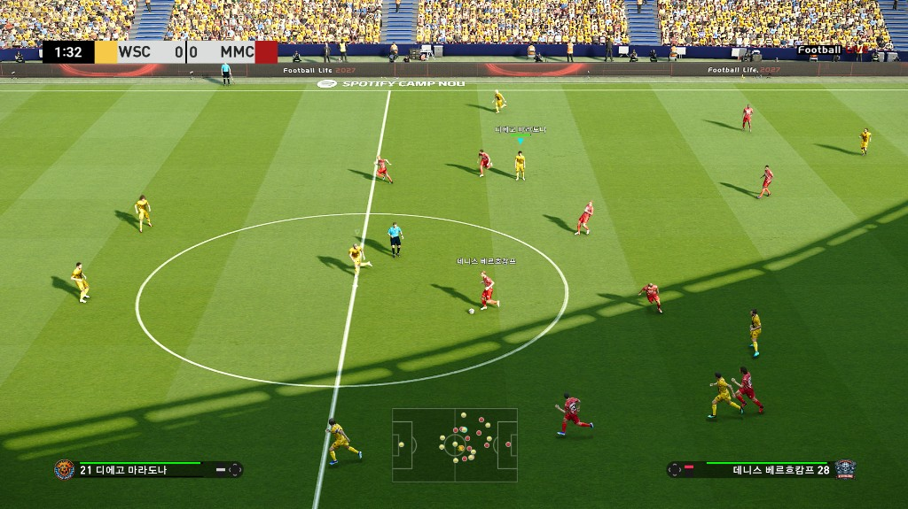

# FL27 선수이름 한글화

SP Football Life 2027용 선수 표시명 한글화 배포물입니다.

> **최신: v1.1.2** — 클래식 로스터 한글 표기 정리.  
> 설치 요지는 [RELEASE_v1.1.2.md](RELEASE_v1.1.2.md) / [릴리즈 페이지](https://github.com/choepd/FL27-player-names-ko/releases/tag/v1.1.2)를 보세요.

## 실제 적용 화면

선수 정보·경기 중 표시명이 한글로 나오는 예시입니다.

## 릴리즈

| 항목 | 내용 |
| --- | --- |
| 최신 릴리즈 | `v1.1.2` (클래식 로스터 표기 정리) |
| 이전 릴리즈 | `v1.1.1`, `v1.1.0`, `v1.0.0` |
| 기준 게임 | SP Football Life 2027 |
| 한글화 명단 | `선수명단 한글 변환용 파일_v12.csv` |
| 한글 `data_s26271.cpk` (v1.1.2) | size `24467008`, md5 `96250a101ee0472d33a1c5a762fb6864` |
| 한글 `data_s2627.cpk` (v1.1.2) | size `3437072`, md5 `52b2e517014a0c562f70a5874c59e68f` |
| 선수 수 | 26,395명 |

v1.0.0은 2026-10-31 시점 영문 `data_s2627.cpk`에 CSV v10을 적용한 한글본입니다.  
v1.1.0은 Smoke Patch 1.1에서 선수명이 `data_s26271.cpk`로 전환된 뒤 한글화한 적용입니다.  
v1.1.1은 같은 Smoke Patch 1.1 기준에서 표기 오류를 추가로 고친 CSV v11 적용본입니다.  
v1.1.2는 Classics 11팀 로스터를 나무위키 기준으로 재정리한 CSV v12 적용본이며, `data_s2627.cpk`와 `data_s26271.cpk`를 모두 갱신합니다.

`FL2710_players.txt`는 2026-10-31 기준 영문 선수 ID + 표시명 목록입니다.

## 포함 파일

| 파일 | 설명 |
| --- | --- |
| `data_s26271.cpk` | Smoke Patch 1.1용 한글 CPK (v1.1.2, 필수) |
| `data_s2627.cpk` | 한글 CPK (v1.1.2, 필수) |
| `선수명단 한글 변환용 파일_v12.csv` | ID·영문·한글 대응표 (참고·재작업용, 게임에 넣지 않음) |
| `선수명단 한글 변환용 파일_v11.csv` | 이전 명단 (참고용) |
| `선수명단 한글 변환용 파일_v10.csv` | 이전 명단 (참고용) |
| `FL2710_players.txt` | 2026-10-31 기준 영문 선수 목록 (`id - english_name`) |
| `README.md` | 이 문서 |
| `images/` | 실제 적용 화면 캡처 |

## 적용 방법

1. 게임을 종료합니다.
2. `download` 폴더의 해당 CPK를 **백업**합니다.
3. 버전에 맞게 덮어씁니다.
   - **Smoke Patch 1.1 / v1.1.x:** `data_s2627.cpk` + `data_s26271.cpk` **둘 다** 교체.
   - **그 이전(v1.0.0 대상):** `data_s2627.cpk`만 교체.
4. 실행 후 선수 이름이 한글로 나오는지 확인합니다.

자세한 문장은 [RELEASE_v1.1.2.md](RELEASE_v1.1.2.md)를 보세요.  
`CSV`와 `FL2710_players.txt`는 설치에 필요하지 않습니다.

## 주의

### 게임 업데이트

- 패치로 선수명 CPK(`data_s2627` / `data_s26271`)나 선수 DB가 바뀌면, 옛 한글 CPK를 그대로 덮어쓰지 마세요.
- 새 선수가 빠지거나, ID가 어긋나거나, 다른 데이터가 손상될 수 있습니다.
- 업데이트 후에는 **그 시점의 영문(미한글) CPK**를 기준으로 다시 한글화해야 합니다. 이 저장소의 CSV는 사전·참고용입니다.
- 게임/패치 버전에 맞는 릴리즈를 쓰세요. (`v1.0.0` ≠ Smoke Patch 1.1)

### ㅁ(미지원 글자)

- 한글 UI 폰트(`dt20_kor_x64.cpk` 등)에 없는 음절은 게임에서 ㅁ으로 보입니다.
- 배포 CSV는 당시 폰트 기준으로 검수한 표기입니다. 폰트가 바뀌면 재검수가 필요합니다.

### 이름 필드 제약 (재작업 시)

- 표시명은 61바이트 NUL 종료 UTF-8이며, 내용은 **60바이트 이하**로 맞춰 주세요.
- 허용 문자는 한글, 공백, 하이픈입니다.
- 호출명·등 이름 필드는 이 배포에서 바꾸지 않았습니다.

## 표기 원칙 (요약)

1. 국내 언론 통용 표기가 있으면 우선합니다. 예: 요한 크루이프, 티에리 앙리.
2. 포르투갈·브라질은 어두 R을 ㅎ으로 적습니다. (호나우두, 히바우두) 국내에 굳은 표기는 예외입니다. (라이 등)
3. 한국 선수는 로마자 음역이 아니라 한국 이름(붙여 쓰기)을 사용합니다.
4. 일본 선수는 성 + 이름 순서를 따릅니다.
5. 철자 장난 직독(예: Rivaldo → 리발도)은 쓰지 않고, 통용·규칙 음역을 사용합니다.
6. 클래식 로스터는 나무위키 본명을 CSV 영문 단어수에 맞춰 자릅니다.

## 버전 이력

- **v1.1.2:** 클래식 로스터(Classics 11팀) 한글 표기 정리. CSV v12·한글 `data_s2627.cpk`·`data_s26271.cpk` 둘 다 갱신.
- **v1.1.1:** Smoke Patch 1.1 표기 수정. CSV v11·한글 `data_s26271.cpk` 갱신. `data_s2627.cpk`는 이전과 동일.
- **v1.1.0:** Smoke Patch 1.1 대응. 한글 `data_s26271.cpk` 추가. `data_s2627.cpk`는 v1.0.0과 동일.
- **v1.0.0** (첫 릴리즈): 기준 데이터 2026-10-31. 한글 CSV v10·한글 `data_s2627.cpk` 포함.

## 라이선스·책임

- 비공식 팬 제작물입니다. Konami 및 FL 제작자와 무관합니다.
- 적용 전 원본 CPK 백업은 사용자 책임입니다.
- 게임 업데이트나 다른 모드와 충돌할 수 있습니다.
